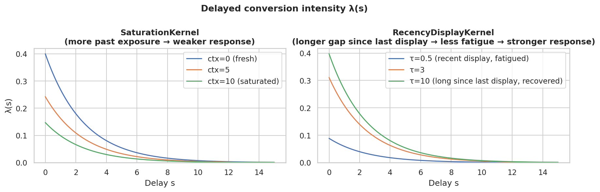

# DynamAuction

[](LICENSE)
[](https://www.python.org/)

**DynamAuction** is a [Gymnasium](https://gymnasium.farama.org/)-compatible reinforcement learning environment for repeated auctions with dynamic display value, the official implementation accompanying the paper:

> *DynamAuction: a reinforcement learning environment for repeated auction with dynamic value*

It is built on a **kernel causal model** that captures realistic advertiser dynamics, frequency saturation, recency effects, delayed conversions, and competitor interference, making it suitable for studying sequential bidding policies in non-stationary settings. The library also ships a modular simulator for multi-policy comparison and a full suite of baseline policies, from simple heuristics to model-predictive control.

---

## Features

- **Flexible scenario builder** — compose kernels, auction rules, competition models, arrival processes, and horizon generators from primitives, or use one of the built-in presets.
- **Gymnasium environment** (`DynamAuction-v0`) — step-by-step interaction with delayed reward delivery and full observation of the kernel state.
- **Multi-policy simulator** — run paired campaigns across seeds with any combination of policies; outputs tidy DataFrames per auction, display, conversion, and episode.
- **Baseline policies** — `FiPlaPolicy`, `ConstantPolicy`, `RandomPolicy`, `GreedyMyopicPolicy`, `ShadingPolicy`, `MPCPolicy`, `MPCOraclePolicy`, `MPCTimeBinnedPolicy`.
- **Benchmark pipeline** — end-to-end reproduction of the paper results: RL training (PPO, SAC, TD3 via Stable Baselines3), MLP valuation head, multi-seed evaluation, and publication-quality plots.

---

## Installation

```bash
git clone <repository-url>
cd dynamauction
pip install -e .                  # core library
pip install -e ".[benchmark]"     # + SB3, TensorBoard, Hydra (for the benchmark pipeline)
pip install -e ".[dev]"           # + pytest, black, flake8
```

**Requirements:** Python 3.9+, pip ≥ 21.3, setuptools ≥ 64.

> `pip install -e .` relies on PEP 660 (editable installs). If it fails with *"missing the `build_editable` hook"*, upgrade first:
> ```bash
> pip install --upgrade pip setuptools
> ```

---

## Quick Start

```python
import dynamauction as dac

# List available preset scenarios
print(dac.list_scenarios())

# Instantiate a preset
scenario = dac.make("survival-second-price-exponential", horizon_eta=50)

# Use as a Gymnasium environment
import gymnasium as gym
env = gym.make("DynamAuction-v0", scenario=scenario)
obs, info = env.reset(seed=42)

done = False
policy = dac.FiPlaPolicy()
while not done:
    bid = policy.bid(obs)
    obs, reward, done, truncated, info = env.step(bid)
```

```python
# Run a paired multi-policy simulation campaign
from dynamauction.simulator import Simulator

policies = {
    "FiPla":   dac.FiPlaPolicy(),
    "Constant": dac.ConstantPolicy(0.5),
    "Random":   dac.RandomPolicy(2.0),
}
sim = Simulator(scenario, policies, campaign_cfg={"n_runs": 30, "seed": 0})
auctions_df, displays_df, conversions_df, summary_df = sim.run()

print(summary_df.groupby("policy")[["win_rate", "n_conversions"]].mean())
```

---

## Model Overview

The library implements a **kernel causal model** for repeated display advertising.
The expected total reward over a campaign horizon $T$ is:

$$R(T) = \sum_{i:\, t_i \le T} \left[ \kappa(u, x_i, x^{-i}, y(t_i)) + \int_0^{T-t_i} \lambda(u, x_i, x^{-i}, y(t_i+s),\, t_i, s)\, ds \right]$$

| Symbol | Description |
|--------|-------------|
| $\kappa$ | Immediate conversion weight at display time |
| $\lambda$ | Delayed conversion intensity (hazard-style) |
| $x^{-i}$ | Carry-over context: aggregates past exposures via $x^{-i} = \bigoplus_{i'<i} \gamma(x_{i'}, t_{i'}, t_i)$ — models ad fatigue and saturation |
| $y(t)$ | Exogenous process: tracks external events (e.g. competitor clicks) that can extinguish pending conversions |

The figure below shows $\lambda(s)$ across the main kernel families:



The figure below shows a sample campaign: grey dots are lost auctions, green dots are won displays, and red stars mark delayed conversions reported back to the agent.


---

## Package Structure

```
dynamauction/
├── primitives/      Auction rules, kernels, competition, arrival, display,
│                    exogenous process, gamma, user features, probe & delay samplers
├── baseline/        Bidding policies (FiPla, Constant, Random, GreedyMyopic,
│                    Shading, MPC variants) and the MLPValuationHead estimator
├── scenarios/       Preset scenario registry and ScenarioBuilder
├── checker/         Gymnasium-style environment sanity checker
├── env.py           Gymnasium-compatible AuctionEnv
├── simulator.py     Multi-policy repeated auction campaign simulator
├── wrappers.py      Observation/action wrappers (Flat, BidScale, SB3, Mask)
└── dataclasses.py   Scenario and AuctionState dataclasses

benchmark/           Full experimental pipeline (training, evaluation, plotting)
docs/                API reference and Jupyter tutorials
figures/             Pre-generated benchmark figures (η = 50 and η = 100)
tests/               Unit test suite
```

---

## Preset Scenarios

| Preset | Kernel | Probe | Use case |
|--------|--------|-------|----------|
| `saturation-second-price-uniform` | `SaturationKernel` | Poisson / Multi | Display retargeting — audience fatigue |
| `recency-second-price-lognormal` | `RecencyDisplayKernel` | Poisson / Multi | Email / push — freshness of last touch |
| `mixed-second-price-exponential` | `MixedKernel` | Poisson / Multi | Rich-media — immediate click-through + delayed view-through |
| `survival-second-price-exponential` | `SurvivalKernel` | Survival / Single | Single-purchase e-commerce — Cox-style model |

---

## Documentation

| Resource | Description |
|----------|-------------|
| [docs/API_REFERENCE.md](docs/API_REFERENCE.md) | Full API reference: scenario creation, simulation, Gymnasium integration, wrappers, and planning baselines |
| [benchmark/BENCHMARK.md](benchmark/BENCHMARK.md) | Experimental protocol, training commands, hyperparameters, and evaluation procedure |
| [docs/dynamauction_tutorial.ipynb](docs/dynamauction_tutorial.ipynb) | Library walkthrough: kernels, probes, scenarios, and environment interaction |
| [docs/simulator_tutorial.ipynb](docs/simulator_tutorial.ipynb) | Simulator walkthrough: single policy, multi-policy comparison, RL training |

---

## Benchmark

The `benchmark/` directory contains the full pipeline for reproducing the paper figures:

1. **Train RL agents** (PPO, SAC, TD3) via Stable Baselines3 + Hydra.
2. **Train the MLP valuation head** used by the MPC policy family.
3. **Run evaluation** across 1 000 seeds for two horizon settings (η = 50, η = 100).
4. **Generate plots** with `benchmark/plots.py`.

Pre-generated figures are available in [`figures/`](figures/).
See [benchmark/BENCHMARK.md](benchmark/BENCHMARK.md) for the complete reproduction guide.

---

## Running Tests

```bash
pip install -e ".[dev]"
pytest tests/
pytest tests/ -m "not slow"   # skip long-running tests
```

---

## Citation

If you use DynamAuction in your research, please cite:

```bibtex
@article{anonymous2025dynamauction,
  title   = {DynamAuction: a reinforcement learning environment for repeated auction with dynamic value},
  author  = {Anonymous Authors},
  year    = {2025},
  note    = {Under review}
}
```
