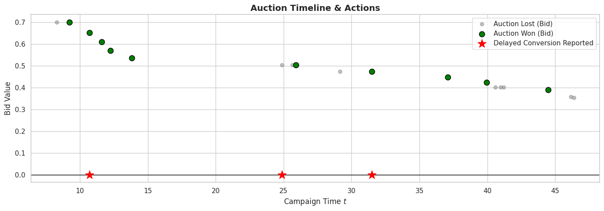
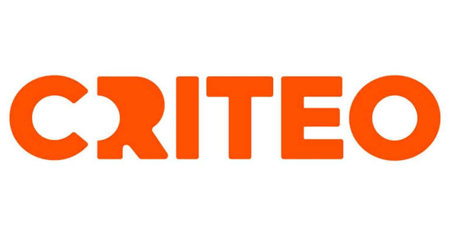

# DynamAuction

[](https://www.python.org/)
[](LICENSE)
[](https://arxiv.org/abs/2611.14000)

**DynamAuction** is a [Gymnasium](https://gymnasium.farama.org/)-compatible reinforcement learning environment for repeated auctions with dynamic display value, the official implementation accompanying the paper:

> *DynamAuction: A Reinforcement Learning Environment for Repeated Auctions with Dynamic Value*,
> Eugenie Patard, Corentin Pla, Benjamin Heymann and Patrick Loiseau, 2026. [arXiv:2611.14000](https://arxiv.org/abs/2611.14000)

It is built on a **kernel causal model** that captures realistic advertiser dynamics, frequency saturation, recency effects, delayed conversions, and competitor interference, making it suitable for studying sequential bidding policies in non-stationary settings. The library also ships a modular simulator for multi-policy comparison and a full suite of baseline policies, from simple heuristics to model-predictive control.

---

## Features

- **Flexible scenario builder** — compose kernels, auction rules, competition models, arrival processes, and horizon generators from primitives, or use one of the built-in presets.
- **Gymnasium environment** (`DynamAuction-v0`) — step-by-step interaction with delayed reward delivery and full observation of the kernel state.
- **Multi-policy simulator** — run paired campaigns across seeds with any combination of policies; outputs tidy DataFrames per auction, display, conversion, and episode.
- **Baseline policies** — `FiPlaPolicy`, `ConstantPolicy`, `RandomPolicy`, `GreedyMyopicPolicy`, `ShadingPolicy`, `MPCPolicy` (rollout options `crn`, `attribution`, `reward`: see [`docs/API_REFERENCE.md`](docs/API_REFERENCE.md#mpcpolicy)), `MPCOraclePolicy`, `MPCTimeBinnedPolicy`.
- **Benchmark pipeline** — end-to-end reproduction of the paper results: RL training (PPO, SAC, TD3 via Stable Baselines3), MLP valuation head, multi-seed evaluation, and publication-quality plots.

---

## Installation

```bash
git clone <repository-url>
cd dynamauction
pip install -e .                  # core library
pip install -e ".[benchmark]"     # + SB3, TensorBoard, Hydra (for the benchmark pipeline)
pip install -e ".[dev]"           # + pytest, black, flake8
```

**Requirements:** Python 3.10+, pip ≥ 21.3, setuptools ≥ 64.

> `pip install -e .` relies on PEP 660 (editable installs). If it fails with *"missing the `build_editable` hook"*, upgrade first:
> ```bash
> pip install --upgrade pip setuptools
> ```

---

## Quick Start

```python
import dynamauction as dac

# List available preset scenarios
print(dac.list_scenarios())

# Instantiate a preset
scenario = dac.make("survival-second-price-exponential", horizon_eta=50)

# Use as a Gymnasium environment
import gymnasium as gym
env = gym.make("DynamAuction-v0", scenario=scenario)
obs, info = env.reset(seed=42)

done = False
policy = dac.FiPlaPolicy()
while not done:
    bid = policy.bid(obs)
    obs, reward, done, truncated, info = env.step(bid)
```

```python
# Run a paired multi-policy simulation campaign
from dynamauction.simulator import Simulator

policies = {
    "FiPla":   dac.FiPlaPolicy(),
    "Constant": dac.ConstantPolicy(0.5),
    "Random":   dac.RandomPolicy(2.0),
}
sim = Simulator(scenario, policies, campaign_cfg={"n_runs": 30, "seed": 0})
auctions_df, displays_df, conversions_df, summary_df = sim.run()

print(summary_df.groupby("policy")[["win_rate", "n_conversions"]].mean())
```

---

## Model Overview

The library implements a **kernel causal model** for repeated display advertising.
The expected total reward over a campaign horizon $T$ is:

$$R(T) = \sum_{i:\, t_i \le T} \left[ \kappa(u, x_i, x^{-i}, y(t_i)) + \int_0^{T-t_i} \lambda(u, x_i, x^{-i}, y(t_i+s),\, t_i, s)\, ds \right]$$

| Symbol | Description |
|--------|-------------|
| $\kappa$ | Immediate conversion weight at display time |
| $\lambda$ | Delayed conversion intensity (hazard-style) |
| $x^{-i}$ | Carry-over context: aggregates past exposures via $x^{-i} = \bigoplus_{i'<i} \gamma(x_{i'}, t_{i'}, t_i)$ — models ad fatigue and saturation |
| $y(t)$ | Exogenous process: tracks external events (e.g. competitor clicks) that can extinguish pending conversions |

The figure below shows $\lambda(s)$ across the main kernel families:


The figure below shows a sample campaign: grey dots are lost auctions, green dots are won displays, and red stars mark delayed conversions reported back to the agent.



---

## Package Structure

```
dynamauction/
├── primitives/         Auction rules, kernels, competition, arrival, display,
│                       exogenous process, gamma, user features, probe & delay samplers
├── baseline/           Bidding policies (FiPla, Constant, Random, GreedyMyopic,
│                       Shading, MPC variants) and the MLPValuationHead estimator
├── scenarios/          Preset scenario registry and ScenarioBuilder
├── checker/            Gymnasium-style environment sanity checker
├── env.py              Gymnasium-compatible AuctionEnv
├── simulator.py        Multi-policy repeated auction campaign simulator
├── wrappers.py         Observation/action wrappers (Flat, BidScale, SB3, Mask)
└── types.py            Scenario and AuctionState dataclasses

benchmark/              Full experimental pipeline (training, evaluation, plotting)
├── conf/               Hydra configuration of the RL trainings (read by train_rl.py):
│                       train.yaml (scenario, 10M steps, seed, output paths) and
│                       algo/{ppo,sac,td3}.yaml (hyperparameters selected on validation campaigns)
├── eval_config.yaml    Evaluation settings (scenario, 1 000 test seeds, models, policy grids)
├── train_rl.py         PPO / SAC / TD3 training (Stable Baselines3)
├── train_mlp.py        Training of the MLP valuation head used by MPC
├── evaluate.py         Evaluation of the policies on the test campaigns
├── tune_*.py           Grid searches of the constant bid and of the Shading α
├── plots.py            Figures of the results notebooks
├── models/             Trained models (MLP valuation head; PPO, SAC, TD3 at η = 50, 3 seeds)
├── benchmark_results/  Evaluation results read by the notebooks (main/, additional/)
├── benchmark_results.ipynb
│                       Main results (η = 50 and 100)
└── additional_bench_results.ipynb
                        Additional experiments (decision time, imperfect value estimates,
                        immediate rewards, other kernels)

docs/                   API reference and Jupyter tutorials
figures/                Pre-generated benchmark figures (main survival scenario, η = 50 and 100;
                        additional experiments)
images/                 Illustrations of this README
tests/                  Unit test suite
```

---

## Preset Scenarios

| Preset | Kernel | Carry-over context | Probe / sampler | Use case |
|--------|--------|--------------------|-----------------|----------|
| `survival-second-price-exponential` | `SurvivalKernel` | multiplicative fatigue (c = 0.9, β = 1) | Bernoulli / single | **Main survival scenario.** Single-purchase e-commerce — Cox-style model, competition LogNormal(−1, 1): winning often makes fatigue matter |
| `survival-second-price-exponential-immediate` | `ImmediateSurvivalKernel` | multiplicative fatigue | none / single | Main survival scenario with the reward at bid time (credit-assignment ablation) |
| `saturation-second-price-lognormal` | `SaturationKernel` | number of wins | Bernoulli / single | Display retargeting — audience fatigue |
| `recency-second-price-lognormal` | `RecencyDisplayKernel` | time of last win | Bernoulli / single | Email / push — freshness of last touch |
| `survival-recovering-second-price-exponential-burst-arrivals` | `SurvivalKernel` | recovering multiplicative fatigue (c = 0.9, β = 0.3) | Bernoulli / single | Every win multiplies the conversion propensity by its own factor 1 − c·e^{−β(t − t_i)}, which recovers slowly; a burst of auctions (rate 10 on [0, 10), then 1), exponential horizon (η = 50): the best shading changes over the campaign |
| `effective-frequency-second-price-lognormal` | `EffectiveFrequencyKernel` | number of wins | Bernoulli / single | Brand / awareness — user/display relevance × wear-in over the first exposures, then wear-out |
| `reminder-second-price-lognormal` | `ReminderKernel` | time of last win | Bernoulli / single | Retargeting — user/display relevance × a reminder converting best some time after the previous contact |
| `mixed-second-price-exponential` | `MixedKernel` | number of wins | Poisson / multi | Rich-media — immediate click-through + delayed view-through |

---

## Documentation

| Resource | Description |
|----------|-------------|
| [docs/API_REFERENCE.md](docs/API_REFERENCE.md) | Full API reference: scenario creation, simulation, Gymnasium integration, wrappers, and planning baselines |
| [benchmark/BENCHMARK.md](benchmark/BENCHMARK.md) | Experimental protocol, training commands, hyperparameters, and evaluation procedure |
| [docs/dynamauction_tutorial.ipynb](docs/dynamauction_tutorial.ipynb) | Library walkthrough: kernels, probes, scenarios, and environment interaction |
| [docs/simulator_tutorial.ipynb](docs/simulator_tutorial.ipynb) | Simulator walkthrough: single policy, multi-policy comparison, RL training |

---

## Benchmark

The `benchmark/` directory contains the full pipeline for reproducing the paper results on the main survival scenario
`survival-second-price-exponential` (η = 50; the results notebook also reports η = 100):

1. **Train RL agents** (PPO, SAC, TD3) via Stable Baselines3 + Hydra (configuration in
   [`benchmark/conf/`](benchmark/conf/)), with the hyperparameters selected on validation campaigns (pretrained models
   are provided).
2. **Train the MLP valuation head** used by the MPC policy family (a trained head is provided).
3. **Run evaluation** on 1 000 test campaigns (`benchmark/eval_config.yaml`).
4. **Explore the results** in `benchmark/benchmark_results.ipynb` (main results) and
   `benchmark/additional_bench_results.ipynb` (decision time, imperfect value estimates, immediate rewards, other kernels).

Pre-generated figures are available in [`figures/eta50/`](figures/eta50/), [`figures/eta100/`](figures/eta100/) and
[`figures/additional-exp/`](figures/additional-exp/) (additional experiments).
See [benchmark/BENCHMARK.md](benchmark/BENCHMARK.md) for the complete reproduction guide.

---

## Running Tests

```bash
pip install -e ".[dev]"
pytest tests/
pytest tests/ -m "not slow and not paper"   # skip the check of the shipped models (tests/integration/)
pytest tests/ -m paper   # check that the code still reproduces the paper's results (benchmark/benchmark_results/main/)
```

The `paper` check is not part of the default run. A failure means that the code now produces results that no longer
align with the paper's results: expected after an intentional change of the model or of the planning code. In CI it
only raises a warning.

---

## Citation

If you use DynamAuction in your research, please cite:

```bibtex
@misc{patard2026dynamauctionreinforcementlearningenvironment,
      title={DynamAuction: A Reinforcement Learning Environment for Repeated Auctions with Dynamic Value},
      author={Eugénie Patard and Corentin Pla and Benjamin Heymann and Patrick Loiseau},
      year={2026},
      eprint={2611.14000},
      archivePrefix={arXiv},
      primaryClass={stat.AP},
      url={https://arxiv.org/abs/2611.14000},
}
```

---

## Authors

DynamAuction is developed by **Eugénie Patard**, **Corentin Pla**, **Benjamin Heymann** and **Patrick Loiseau**, members of
[FairPlay](https://team.inria.fr/fairplay/), a joint research team of [Inria](https://www.inria.fr),
[CREST](https://crest.science) ([ENSAE Paris](https://www.ensae.fr), Institut Polytechnique de Paris) and
[Criteo](https://www.criteo.com). FairPlay studies fairness, privacy and incentives in auctions and matching
markets, with tools from game theory and machine learning.

<p align="center">
  <a href="https://www.inria.fr"></a>
  &emsp;&emsp;
  <a href="https://crest.science"></a>
  &emsp;&emsp;
  <a href="https://www.criteo.com"></a>
</p>


## Contributing

Contributions are welcome: see [CONTRIBUTING.md](CONTRIBUTING.md) for the development setup, the tests and how to open
a pull request. Everyone taking part in the project is expected to follow the [Code of Conduct](CODE_OF_CONDUCT.md).

## License

This project is licensed under the MIT License.
See the [LICENSE](LICENSE) file for details.
Contributions are accepted under the same MIT License.

